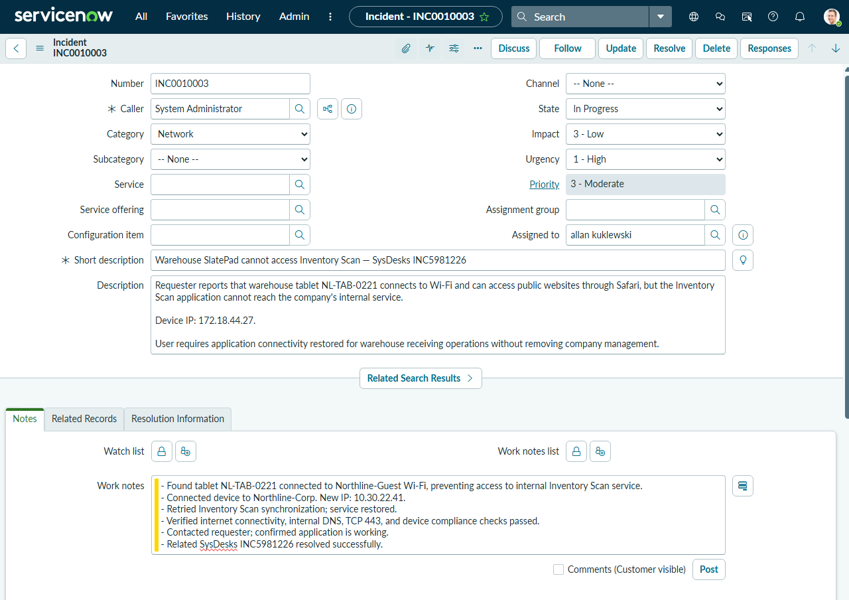
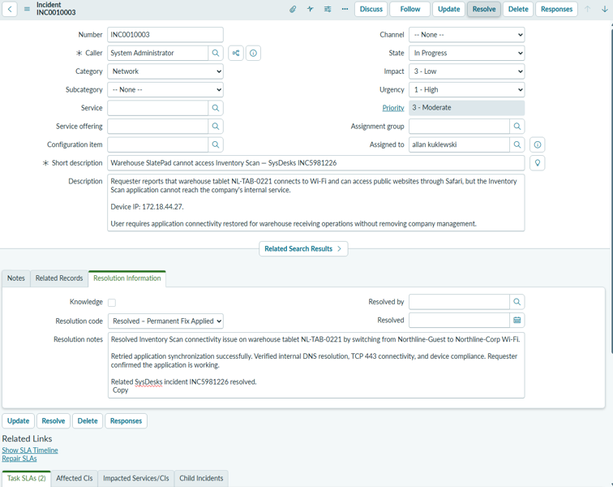

# Lab 01 — Warehouse Tablet Connectivity

## 1. Incident Overview
A warehouse tablet could browse public websites but could not reach the internal Inventory Scan application, interrupting receiving operations.

**SysDesks:** INC5981226 · **Priority:** P3 Moderate · **ServiceNow:** INC0010003

## 2. Tools & Environment
- **SysDesks:** Simulated tablet troubleshooting, requester messaging, and ticket resolution
- **ServiceNow PDI:** Matching incident, assignment, work notes, and resolution documentation
- **Device:** Orchard SlatePad, `NL-TAB-0221` · **Application:** Inventory Scan

## 3. Troubleshooting & Investigation
1. Assigned the SysDesks ticket and created a matching ServiceNow incident.
2. Opened the simulated tablet's Wi-Fi settings and found it connected to **Northline-Guest**.
3. Switched the tablet to **Northline-Corp** which is used for the company's internal network. I retried Inventory Scan synchronization and made connection.

**ServiceNow — Incident Investigation and Work Notes**

## 4. Root Cause & Resolution
The tablet was on guest Wi-Fi, which did not provide access to the internal Inventory Scan service. Connecting to corporate Wi-Fi restored service without removing device management.

## 5. Verification & Results
- Inventory Scan reported **Service online** and synchronized the warehouse catalog.
- Corporate IP: `10.30.22.41`; private DNS and TCP **443** checks passed.
- Managed profile remained present; requester confirmed the application worked.
- **SysDesks incident resolved** with code *Solved Permanently*.

## 6. Lessons Learned
Public internet access does not guarantee access to private company services. I verified the connected network, tested the affected application, and confirmed the fix with the requester.

