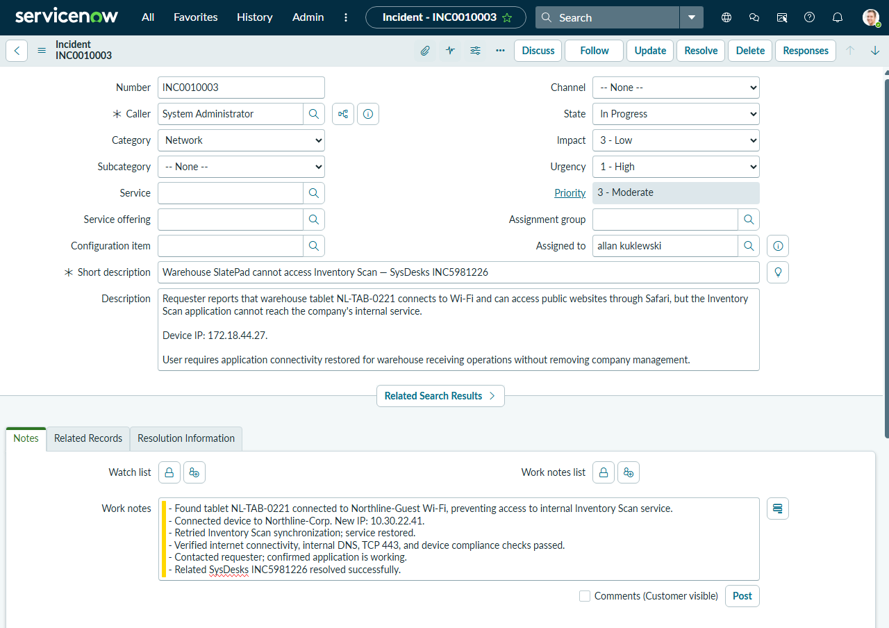
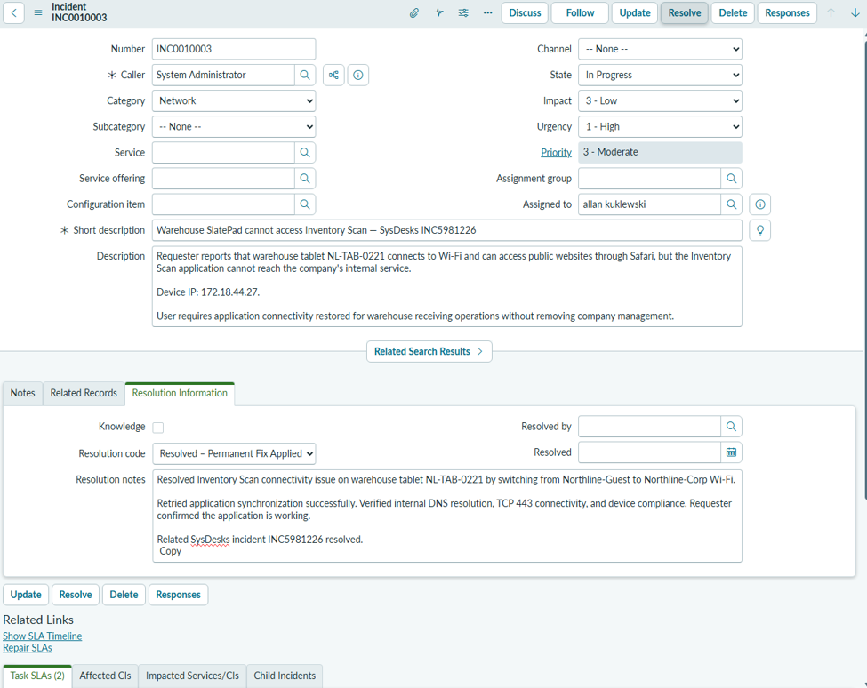
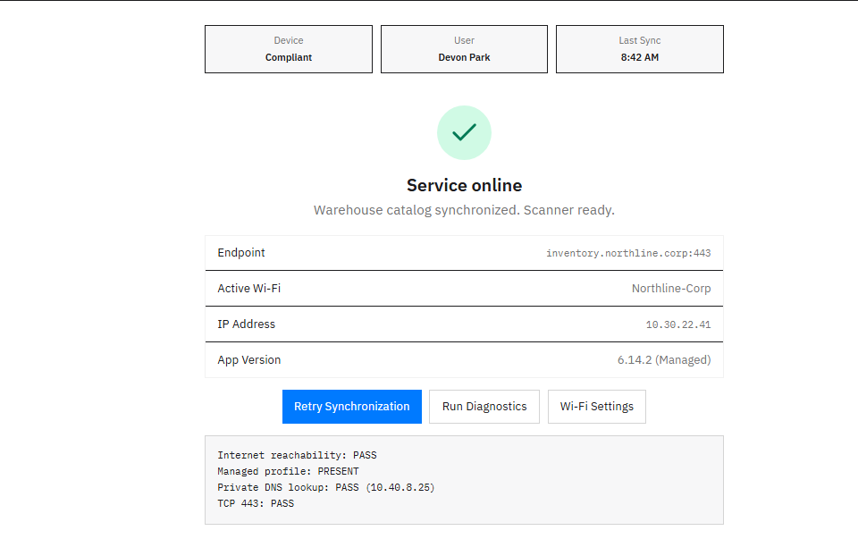
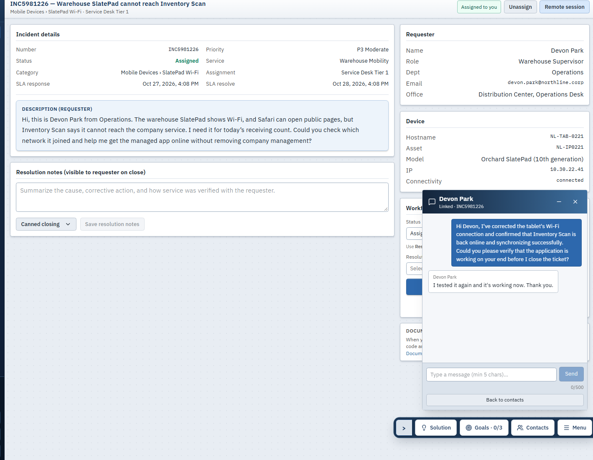

# Lab 01 — Warehouse Tablet Connectivity

## 1. Incident Overview
A warehouse employee reported that their tablet could access regular websites but could not connect to the company's internal Inventory Scan application. This prevented them from using the application for receiving operations.

**SysDesks:** INC5981226 · **ServiceNow:** INC0010003 · **Priority:** P3 Moderate

## 2. Tools & Environment
- **SysDesks:** Simulated tablet troubleshooting and requester communication
- **ServiceNow PDI:** Incident tracking, work notes, and resolution documentation
- **Device:** Orchard SlatePad (`NL-TAB-0221`)
- **Application:** Inventory Scan

## 3. Troubleshooting & Investigation
I started by reviewing the reported issue in SysDesks and creating a matching incident in ServiceNow to document the troubleshooting process.

While checking the tablet's network settings, I found it was connected to **Northline-Guest** instead of the company's corporate Wi-Fi. This explained why the tablet could access the internet but not the internal application.

I switched the tablet to **Northline-Corp** and tested Inventory Scan again.

I also documented the issue, investigation, and troubleshooting steps in ServiceNow incident INC0010003.

## 4. Root Cause & Resolution
The tablet was connected to the guest wireless network, which did not have access to the company's internal Inventory Scan service.

Switching to the corporate Wi-Fi restored the connection without changing or removing the tablet's management settings.

I entered the resolution details in ServiceNow, including the network change and the checks performed afterward.

## 5. Verification & Results
After switching networks, I verified that:

- Inventory Scan showed **Service online** and successfully synchronized.
- The tablet received corporate IP address `10.30.22.41`.
- Internal DNS and TCP port **443** connectivity checks passed.
- The device management profile remained compliant.
- The requester tested the application and confirmed it was working.

The SysDesks incident was then marked **Solved Permanently**.

## 6. Lessons Learned
This lab showed me that having an internet connection doesn't always mean a device can access company resources. Checking which network the device was connected to helped identify the problem. It also reinforced the importance of testing the application afterward and confirming the fix with the user.

*Simulated help desk scenario using SysDesks and ServiceNow.*
