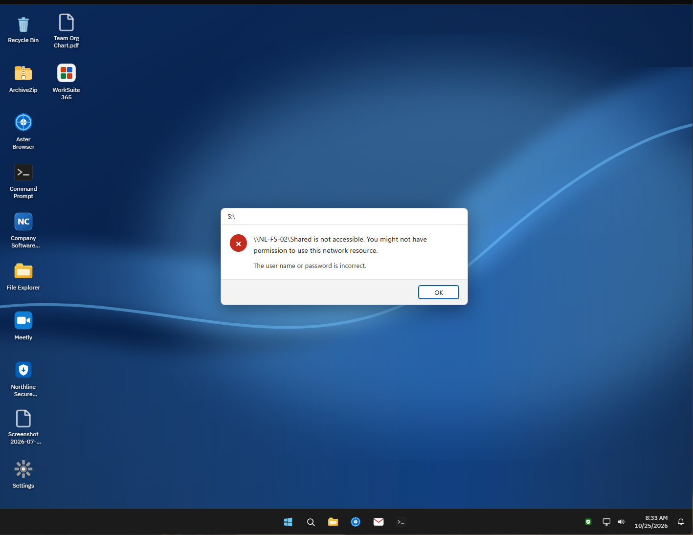
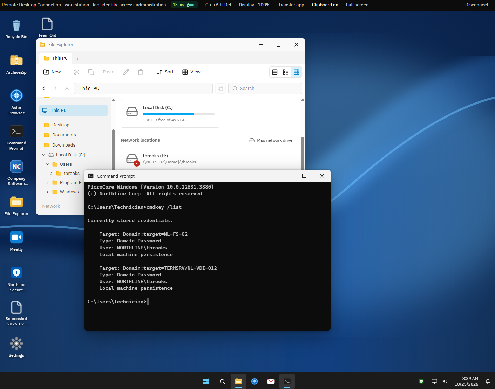
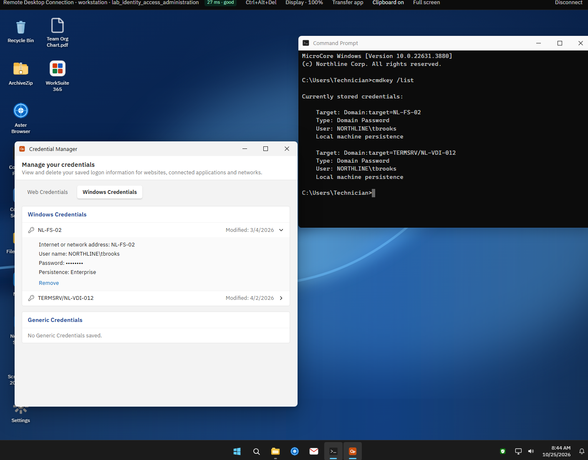
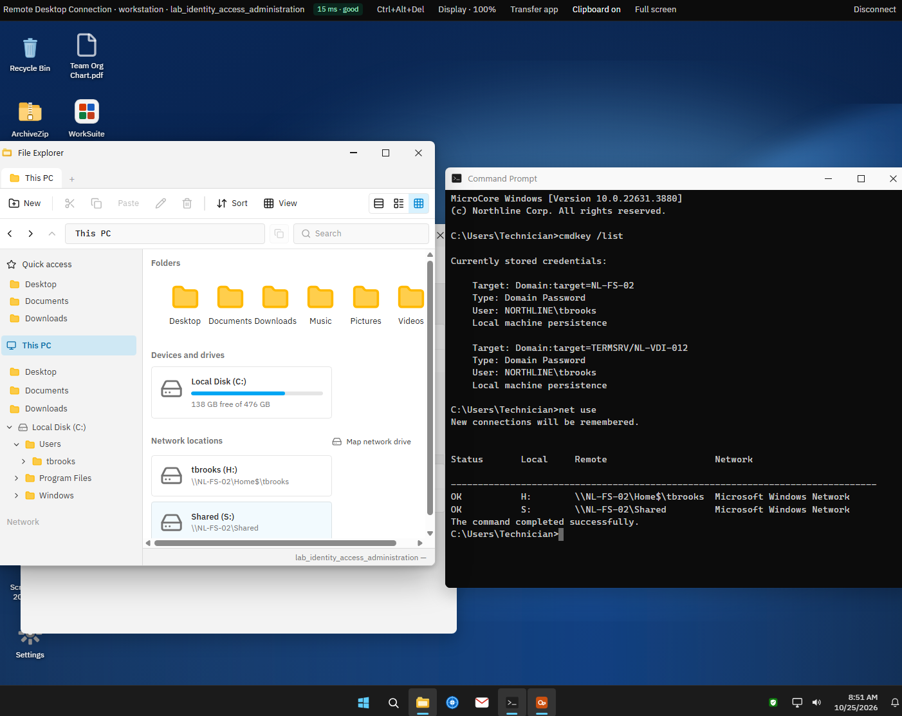
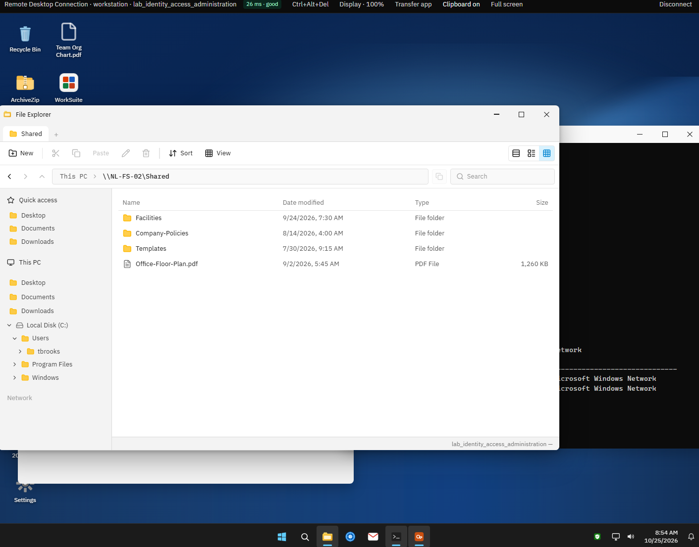
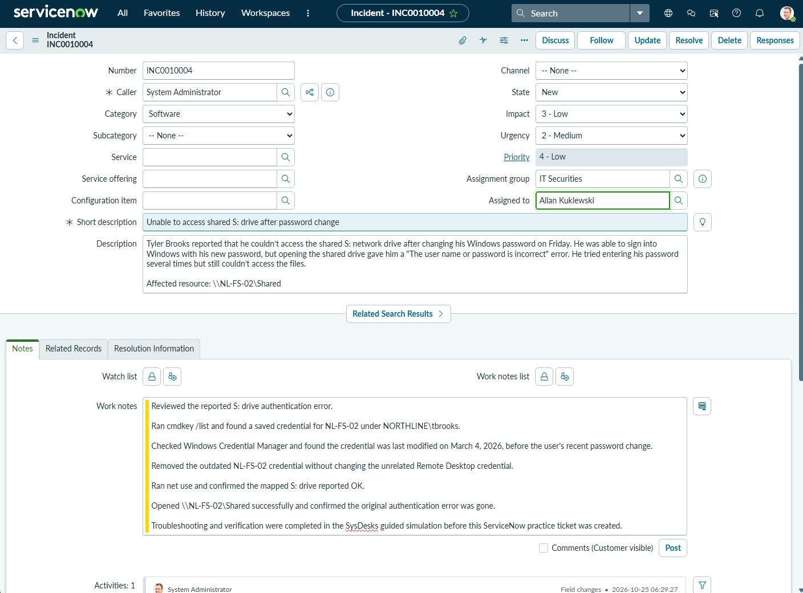

# Lab 02 — Network Share Authentication Failure

*SysDesks guided training · Identity and Access Administration (ID-AD-2204) · Problem 1*

## 1. Incident Overview

Tyler Brooks changed his Windows password, but afterward he couldn't open his mapped S: drive. Windows sign-in worked, while the shared drive kept saying the username or password was incorrect. I worked through this issue in SysDesks' guided Identity and Access Administration training.

*Original S: drive authentication error*

## 2. Tools & Environment

SysDesks simulated Windows workstation, File Explorer, Command Prompt, and Windows Credential Manager. I used `cmdkey /list` and `net use` to check stored credentials and mapped drives. I also used a separate ServiceNow developer instance to practice ticket documentation afterward.

## 3. Troubleshooting & Investigation

I started by reproducing the S: drive error. Then I ran `cmdkey /list` and found a saved credential for `NL-FS-02` under `NORTHLINE\tbrooks`. Credential Manager showed that the entry was last modified on March 4, 2026, before Tyler's recent password change. I also found a Remote Desktop credential, but it wasn't related to the issue.

*Checking saved credentials with cmdkey /list*

*Saved NL-FS-02 credential in Windows Credential Manager*

## 4. Root Cause & Resolution

The saved credential for `NL-FS-02` was outdated, so Windows was using the wrong password for the shared drive. I removed only that credential from Credential Manager and left the unrelated Remote Desktop entry alone.

## 5. Verification & Results

After the change, I ran `net use` and confirmed the S: drive showed **OK**. Then I opened `\\NL-FS-02\Shared` in File Explorer and could see the shared files without getting the password error. SysDesks confirmed all four steps passed.

*net use shows the S: drive connected*

*The Shared (S:) folder opens successfully*

## 6. Lessons Learned

I learned that signing into Windows successfully doesn't always mean a mapped drive is using the right credentials. Checking saved passwords first can save time, and testing the actual drive that failed is important before calling the problem fixed.

Because this guided SysDesks exercise didn't include a help desk ticket, I created **ServiceNow incident INC0010004 afterward** to practice documenting the original issue, category, impact, urgency, assignment, troubleshooting, and fix. The screenshot shows the practice ticket in **New** state, not Resolved. SysDesks and ServiceNow were separate systems; no integration was involved.

*ServiceNow practice incident INC0010004 documenting the completed exercise*
